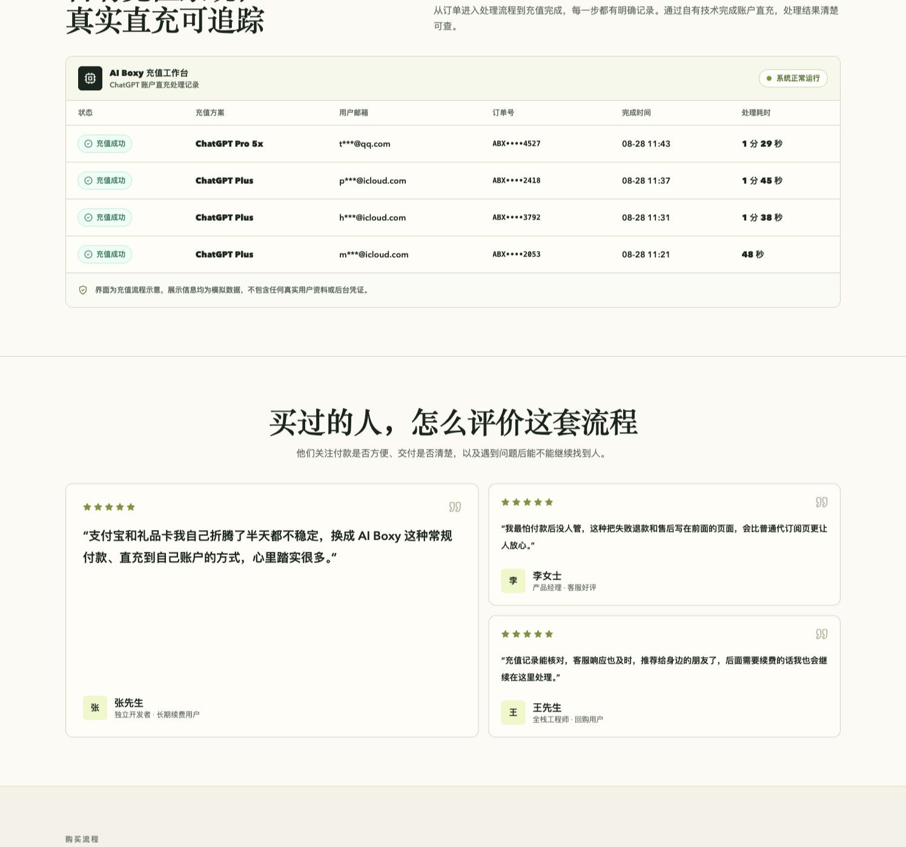

# ChatGPT Plus/Pro Codex 5.6 Sol、Terra、Luna｜代充 充值 完整指南

> 本文更新于 2026 年 11 月 11 日。支付规则、价格和可用地区会变化，下单前请以服务方页面为准。

人在国内，没有海外信用卡，怎么把自己的 ChatGPT 账号升级成 Plus/Pro？目前能走的路径不少，但门槛、成功率和操作成本差别很大。这篇文章把常见方法放在一起，按自己的设备和支付条件选择即可。

常见方法包括人民币自助服务、海外信用卡、PayPal、App Store 或 Google Play 礼品卡、虚拟信用卡和共享账号。看起来每条路都能走，真正操作时却各有门槛：有的容易支付失败，有的流程复杂，还有的虽然便宜，聊天记录和账号却不在自己手里。

如果只想先看结论：

- 没有海外卡，又不想折腾：直接选人民币代充，支付宝、微信付款，直充本人账户，订单可查、有售后质保。
- 已经有能稳定扣款的海外卡：也可以自己绑卡订阅，但要自己处理扣款被拒和续费失败。
- 熟悉苹果或安卓商店：可以研究对应地区的礼品卡和订阅规则。
- 共享账号：聊天记录和文件不在自己手里，想长期用还是选本人账户充值。

## 方法一：人民币自助服务，目前最省事的选择

### 适合谁？

- 没有海外信用卡；
- 不想研究虚拟卡和账单地址；
- 不想折腾美区 Apple ID 或 Google Play；
- 使用安卓或 Windows，没有苹果设备；
- 临时急用 Plus，希望尽快完成订阅；
- 公司付款，需要保留订单凭证。

自助服务的基本流程是：用人民币购买订阅方案，支付后按页面提示把权益交付到自己的 ChatGPT 账号。选择平台时，重点不是页面写的最低价格，而是价格、订单、交付和售后有没有公开说明。

AI Boxy 是本指南关联的自有服务，购买页会展示当前开放的 ChatGPT 方案、支付方式和处理说明。支持支付宝、微信付款，直充你本人的账户，所有套餐均为质保订阅，订阅期内有售后保障。

👉 **[查看 AI Boxy 当前方案](https://www.ai2boxy.com/zh/purchase/)**

*AI Boxy 购买页示例：方案、订单进度和售后入口都在页面上。*

### 选择自助服务时看什么？

- 是否有明确的商品价格和操作步骤；
- 是否支持订单查询，支付后能否找到交付信息；
- 是否公开退款、失败处理和售后规则；
- 是否有能联系到人工客服的入口；
- 是否要求把账号密码或验证码交给客服；
- 是否持续维护网站，而不是临时收款页面。

### 优点

- **操作省事：** 不用申请虚拟卡，也不用切换 App Store 地区。
- **国内支付友好：** 按页面支持的人民币方式付款。
- **不挑设备：** 完成订阅后按 ChatGPT 账号状态使用。
- **订单可追踪：** 支付、交付和售后围绕订单号继续处理。
- **客服响应及时：** 遇到支付、交付或账号状态异常时，可以联系 AI Boxy 在线客服，客服会结合订单号及时回复并继续跟进处理。

### 下单小贴士

- **售后质保：** 订阅期内遇到问题，带上订单号联系在线客服即可继续处理。
- **价格看下单页：** 汇率和渠道成本会影响价格，以下单页实时价格为准。
- **按需购买：** 先按当前需要选择套餐周期，到期前再续费即可。
- **不要交出密码：** 正规流程只需你本人登录，不需要把密码交给任何人。

## 方法二：海外信用卡自己绑卡

如果你有海外发行的 Visa、Mastercard 或 American Express，可以自己在 ChatGPT 页面绑卡订阅，账单、续费和取消都需要自己管理。

国内发行的双币卡不代表一定能通过。支付是否成功会受到发卡地区、账单资料、账号地区和实时风控影响。使用自己的银行卡给 Plus 或 Pro 付款时，比较常见的问题就是卡片触发支付风控，扣款被拒，或者首次付款成功但后续续费失败。

出现被拒时，不一定是卡里没钱，也可能是发卡行拦截、卡段不被Stripe接受、账单地址不匹配，或支付平台判断交易风险较高。不要短时间连续反复提交同一张卡，否则可能进一步触发卡片或账号侧的风控。

### 优点与限制

- 优点：有合适的卡时可以自己操作。
- 限制：需要合适的卡和账单资料，遇到卡片风控、扣款被拒或续费失败时，千万不要频繁尝试；没有合适的卡，直接选方法一更省事。

## 方法三：PayPal 或其他外币支付

如果 PayPal 已经绑定可用的外币卡，可以尝试在官方订阅页面付款。国内注册的 PayPal 如果只绑定银联卡，通常不能绕过海外支付门槛，因此这条路并不适合所有人。

使用 PayPal 付款时，先确认币种、退款条件和自动扣款设置。不要为了测试支付，把大量余额长期留在陌生账户里。

## 方法四：App Store 或 Google Play 礼品卡

### 苹果用户

需要符合条件的 Apple ID、对应地区的礼品卡或外币支付方式，以及官方 ChatGPT App。礼品卡地区必须和 Apple 账户地区匹配，主账户已有订阅或余额时，不要贸然切换地区。

### 安卓用户

Google Play 路径同样受账号地区、礼品卡来源和应用可用性影响。注册、充值和后续续费比网页直付多几步，开始前先确认自己的账户是否满足条件。

**提醒：** 礼品卡不是万能解法，溢价、地区限制和余额退款规则都要在购买前核对。

## 方法五：虚拟信用卡 VCC，适合愿意自己折腾的人

虚拟卡看起来门槛低，但支付风控、卡段可用性和余额取回都存在不确定性。开卡费、充值费和月费也会增加真实成本。

- 支付被拒是常见情况，反复试卡可能触发额外风控；
- 平台停止服务或冻结卡片后，余额处理可能很麻烦；
- 卡片能完成一次付款，不代表自动续费可以长期运行；
- 不熟悉发卡平台和国际支付规则的话，直接选人民币代充更省事。

## 方法六：低价共享账号，便宜但账号不归你

共享账号的操作最简单：付款后，卖家提供一组邮箱和密码，多个人登录同一个 Plus 账号。它唯一明显的优势是价格低，但问题也很直接：

- 其他人可能看到你的聊天记录；
- 上传的代码、文档和图片可能泄露；
- 卖家随时可以修改密码；
- 多人异地登录容易触发验证或限制；
- 账号失效后很难追责。

只要涉及工作资料、学习资料、简历、合同、代码或个人信息，就不要使用共享账号。

## 六种方式怎么选？

| 方式 | 操作难度 | 账号掌控 | 主要成本 | 适合人群 | 建议 |
| --- | --- | --- | --- | --- | --- |
| 人民币自助服务 | 低 | 自己的账号 | 人民币套餐价 | 没有海外卡、想省事 | 推荐，有售后质保 |
| 海外信用卡 | 高 | 自己的账号 | 官方套餐价和可能的税费 | 有稳定海外支付方式 | 有卡可试 |
| PayPal | 中高 | 自己的账号 | 需要可用外币卡 | 已有 PayPal 的用户 | 有条件可试 |
| App Store / Google Play | 中 | 自己的账号 | 礼品卡溢价和地区限制 | 熟悉商店规则的人 | 先核对地区 |
| 虚拟信用卡 | 中 | 自己的账号 | 开卡、充值和风控成本 | 熟悉国际支付的人 | 门槛较高 |
| 共享账号 | 低 | 不掌控账号 | 通常最低 | 无隐私的临时测试 | 不推荐 |

## 充值前后的安全检查

1. 只在自己登录的账号和可信页面操作，不要把 ChatGPT 密码、验证码交给任何人。
2. 保存订单号、付款截图和服务说明，付款前先确认退款边界。
3. 充值完成后回到 ChatGPT 的账户或套餐页面，确认 Plus 状态真的生效。
4. API Key 只在 OpenAI 自己的页面里使用，也不要把长期有效的登录凭证发给任何人。

## 常见问题

### 国内没有海外信用卡，怎么订阅 ChatGPT Plus？

最省事的是人民币代充：支付宝、微信付款，直充本人账户。选服务时看四点：订单可查、交付流程清楚、有售后质保、客服能及时回复。

### 订阅需要把 ChatGPT 密码给客服吗？

不需要。AI Boxy 的流程由你本人登录完成，不需要把密码或验证码交给客服。

### ChatGPT Plus 包含 API 额度吗？

不包含。ChatGPT Plus 和 OpenAI API 是两套独立的产品与计费体系。

### 已有 Plus 还能继续充值吗？

先确认当前订阅的到期时间和服务方规则。重复购买、覆盖订阅或选错账号时，剩余时间不一定顺延。

## 更多专题教程

- [AI Boxy 知识库：充值、套餐选购与问题排查](https://github.com/aiboxy49-boop/chatgpt-plus-pro-daichong-chongzhi/tree/main/knowledge)
- [官网博客与充值指南](https://www.ai2boxy.com/zh/guides/)
- [国内怎么订阅 ChatGPT Plus：四种方式说明](articles/chatgpt-plus-recharge.html)
- [海外卡、礼品卡和自助服务：支付方式对比](articles/payment-options.html)
- [ChatGPT 订阅时如何保护账号](articles/account-safety.html)

## 总结

国内订阅 ChatGPT Plus，真正实用的判断标准不是哪家价格最低，而是账号是不是自己的、付款后能不能查询订单、失败后有没有售后、整个流程是否清楚透明。

- 没有海外卡、不想研究虚拟卡，直接选人民币代充：直充本人账户，订单可查，订阅期内有售后质保；
- 已有稳定可用的海外卡，也可以自己绑卡；
- 熟悉商店规则，可以考虑 App Store 或 Google Play；
- 不要把账号密码、验证码或敏感 Session 交给任何人，也不要使用共享账号处理隐私内容。

👉 **[查看 AI Boxy 当前订阅方案](https://www.ai2boxy.com/zh/purchase/)**

> ChatGPT 和 Apple 是其各自权利人的商标。套餐和价格会随官方调整更新，AI Boxy 的实时方案请看官网套餐页。
